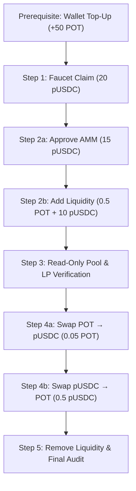

# PortalNexus — Architecture A Transaction Test Plan (NO EXECUTION)

**Document Type:** Formal Transaction Specification & Safety Assessment  
**Execution Authorization:** **STRICTLY PROHIBITED (PLANNING ONLY)**  
**Network:** Portaldot V3 Testnet (`Chain ID 420420777` / `0x190f1ca9`)  
**EVM RPC:** `https://test-evm-rpc-v3.portaldot.dev`  
**Deployer Address:** `0xdC7f5c7813a5f0e3F51c2Fe569DE6C5577768A2A`  
**Deployed pUSDC Contract:** [`0x6C3BD7AD92862bB321B34a2F2762E7F2B7824002`](file:///C:/Users/NO%20GO%20NO/PortalNexus/contracts/contracts/TestUSDCMin.sol)  
**Deployed Native AMM Contract:** [`0x407A2609dfd5336a38D6274B1EFc1804930f160A`](file:///C:/Users/NO%20GO%20NO/PortalNexus/contracts/contracts/NexusAMMNative.sol)  
**Safety Status:** Zero transactions signed or broadcast; UI transaction buttons remain disabled. `Portaldot Sentinel` strictly untouched.

---

## 1. Executive Summary & Live State Assessment

Before committing real transactions on Portaldot V3 Testnet, we performed live RPC queries at Block `#237704` to audit fee mechanics, current balances, and storage deposit requirements.

### Live Network & Deployer Telemetry
- **Latest Block Number:** `237704`
- **Deployer EVM Nonce:** `2` (TestUSDCMin at nonce 0, NexusAMMNative at nonce 1)
- **Current Deployer Balance:** `13.088472 POT` (`13,088,472,552,168,753,000` wei)
- **Live Base Fee / Gas Price (`eth_gasPrice`):** `27,595 wei` (`0x6bcb`)
- **Deployed Pool State:**
  - `getReserves()`: `(reservePOT = 0, reserveUSDC = 0)`
  - `totalLiquidityShares()`: `0`
  - `balanceOf(deployer)` on pUSDC: `0`
  - `allowance(deployer, AMM)`: `0`

### Empirical Resource & Storage Deposit Discovery
Portaldot V3 operates under Substrate's `pallet_revive` runtime. Storage in `pallet_revive` requires **refundable state collateral (storage deposit)** bundled directly into `eth_estimateGas` ($\text{Gas} = \text{ExecutionGas} + \frac{\text{StorageDeposit}}{\text{gasPrice}}$).

We executed live `eth_estimateGas` simulations against the deployed contracts to determine real transaction resource requirements:
1. **`faucetMint(deployer, 100 pUSDC)`:**
   - Raw estimated gas: `283,477,365,028,511` units
   - Implied transaction cost: $\mathbf{7.8226\text{ POT}}$ ($7,822,557,887,961,761,045\text{ wei}$)
   - *Reason:* Creating a new `balanceOf[deployer]` storage slot in the contract's Substrate storage trie incurs the trie item base deposit ($\sim 7.8\text{ POT}$).
2. **`approve(AMM, 50 pUSDC)`:**
   - Raw estimated gas: `142,092,179,021,109` units
   - Implied transaction cost: $\mathbf{3.9210\text{ POT}}$ ($3,921,033,690,087,502,855\text{ wei}$)
   - *Reason:* Creating a new nested mapping entry `allowance[deployer][AMM]` in the storage trie incurs the trie item base deposit ($\sim 3.9\text{ POT}$).

### Critical Capital Budget Finding
$$\text{Deployer Balance} = 13.0885\text{ POT}$$
$$\text{Cost for Step 1 (Faucet)} + \text{Cost for Step 2a (Approve)} = 7.8226 + 3.9210 = \mathbf{11.7436\text{ POT}}$$
$$\text{Remaining Balance Before Adding Liquidity} = 13.0885 - 11.7436 = \mathbf{1.3449\text{ POT}}$$

> [!WARNING]
> **Wallet Capital Warning:**
> Calling `addLiquidity` on `NexusAMMNative` writes **three brand-new storage items**:
> 1. `ownerOf[1]`
> 2. `balanceOf[deployer]`
> 3. `_positions[1]` (struct containing 5 full words: pool, shares, potDeposited, usdcDeposited, timestamp)
>
> Writing these 3 storage items requires an estimated **$15\text{ to }25\text{ POT}$** in state deposits plus the native POT deposited (`msg.value`).
> With only **$1.3449\text{ POT}$** remaining after Faucet and Approve, **the deployer wallet will run out of funds during Step 2 unless funded with an additional $50\text{ to }100\text{ tPOT}$ from the Portaldot community faucet prior to testing.**

---

## 2. Contract Mathematical Constraints & Minimums

### A. TestUSDCMin Faucet Constraints
- Contract interface: `faucetMint(address to, uint256 amount)`
- Decimals: `6` ($1\text{ pUSDC} = 10^6\text{ units}$)
- Minimum valid amount: $1\text{ base unit}$ ($0.000001\text{ pUSDC}$)
- Maximum valid amount: `MAX_MINT_PER_CALL = 10_000 * 10^6` ($10,000\text{ pUSDC}$)
- Revert conditions: `to == address(0)`, `amount == 0`, `amount > MAX_MINT_PER_CALL`
- **Recommended Test Claim:** **$20.00\text{ pUSDC}$** (`20,000,000` base units). Sufficient for liquidity provision ($10\text{ pUSDC}$) and test swap ($1\text{ pUSDC}$) while staying far below the cap.

### B. NexusAMMNative Minimum Liquidity & Invariant Rules
- Permanent burned shares: `MINIMUM_LIQUIDITY = 1000`
- Initial deposit share calculation:
  $$\text{shares} = \lfloor\sqrt{\text{amountPOT} \times \text{amountUSDC}}\rfloor - 1000$$
  $$\text{totalLiquidityShares} = \text{shares} + 1000$$
- Strict invariant requirement: `shares > 0` $\implies \sqrt{\text{amountPOT} \times \text{amountUSDC}} > 1000$
- **Decimal unit scaling:**
  - Native POT has 18 decimals: $1\text{ POT} = 10^{18}\text{ wei}$
  - pUSDC has 6 decimals: $1\text{ pUSDC} = 10^6\text{ units}$
  - If depositing $0.5\text{ POT}$ ($5 \times 10^{17}\text{ wei}$) and $10.0\text{ pUSDC}$ ($10 \times 10^6\text{ units}$):
    $$\text{Product} = (5 \times 10^{17}) \times (10 \times 10^6) = 5 \times 10^{24}$$
    $$\sqrt{5 \times 10^{24}} \approx 2,236,067,977,499\text{ shares}$$
    $$\text{Minted LP Shares} = 2,236,067,977,499 - 1000 = 2,236,067,976,499\text{ shares}$$
    $$\text{Total Pool Shares} = 2,236,067,977,499$$

### C. Permanently Trapped Capital Accounting
When liquidity is removed via `removeLiquidity(tokenId, minAmountPOT, minAmountUSDC, to, deadline)`:
$$\text{Refunded POT} = \frac{\text{shares} \times \text{reservePOT}}{\text{totalLiquidityShares}}$$
$$\text{Refunded pUSDC} = \frac{\text{shares} \times \text{reserveUSDC}}{\text{totalLiquidityShares}}$$
The 1000 unminted shares permanently lock an infinitesimal fraction of reserves in the pool:
$$\text{Trapped POT} = \frac{1000}{2,236,067,977,499} \times 0.5\text{ POT} \approx 2.23 \times 10^{-10}\text{ POT} \approx 223,606,797\text{ wei}$$
$$\text{Trapped pUSDC} = \frac{1000}{2,236,067,977,499} \times 10\text{ pUSDC} \approx 4.47 \times 10^{-12}\text{ pUSDC} = 0\text{ base units (rounds down)}$$
*Conclusion:* The financial capital trapped by `MINIMUM_LIQUIDITY` is negligible ($< 0.000000001\text{ POT}$). However, the Substrate **storage deposits** for newly created trie items remain locked as state collateral until/unless deleted.

---

## 3. Sequential 5-Step Execution Plan

---

### Step 1: Claim pUSDC via Verified Faucet

- **Target Contract:** `0x6C3BD7AD92862bB321B34a2F2762E7F2B7824002` (`TestUSDCMin`)
- **Function:** `faucetMint(address to, uint256 amount)`
- **Selector:** `0xa5c51274`
- **Arguments:**
  - `to`: `0xdC7f5c7813a5f0e3F51c2Fe569DE6C5577768A2A` (Deployer wallet)
  - `amount`: `20_000_000` ($20.00\text{ pUSDC}$, $20 \times 10^6$)
- **Calldata:**
  `0xa5c51274000000000000000000000000dc7f5c7813a5f0e3f51c2fe569de6c5577768a2a0000000000000000000000000000000000000000000000000000000001312d00`
- **Transaction Value:** `0 wei` (`0.00 POT`)
- **Required Wallet:** Deployer EVM Private Key / Connected Provider
- **Approvals Required:** None
- **Resource Cost Estimate:**
  - Gas: $\approx 283,477,365,028,511\text{ units}$
  - Cost: $\approx \mathbf{7.82\text{ POT}}$ (Trie storage deposit for `balanceOf[deployer]` slot)
- **Potential Failure Modes:**
  - Request amount exceeds `10,000 * 10^6` (reverts).
  - Insufficient POT for transaction fee + storage deposit (fails with code `-32000`).
  - RPC timeout during state write.
- **Success Verification:**
  - Transaction receipt `status == 1`.
  - Event `FaucetMinted(0xdC7f...8A2A, 20000000)` emitted.
  - Event `Transfer(0x0, 0xdC7f...8A2A, 20000000)` emitted.
  - On-chain read `balanceOf(deployer)` returns `20_000_000` ($20.00\text{ pUSDC}$).
  - On-chain read `totalSupply()` returns `20_000_000`.

---

### Step 2: Approve Allowance & Add Initial Liquidity

#### Step 2a: Approve pUSDC for AMM
- **Target Contract:** `0x6C3BD7AD92862bB321B34a2F2762E7F2B7824002` (`TestUSDCMin`)
- **Function:** `approve(address guy, uint256 wad)`
- **Selector:** `0x095ea7b3`
- **Arguments:**
  - `guy`: `0x407A2609dfd5336a38D6274B1EFc1804930f160A` (`NexusAMMNative`)
  - `wad`: `15_000_000` ($15.00\text{ pUSDC}$, covers $10\text{ pUSDC}$ deposit + $5\text{ pUSDC}$ buffer for testing)
- **Calldata:**
  `0x095ea7b3000000000000000000000000407a2609dfd5336a38d6274b1efc1804930f160a0000000000000000000000000000000000000000000000000000000000e4e1c0`
- **Transaction Value:** `0 wei`
- **Resource Cost Estimate:**
  - Gas: $\approx 142,092,179,021,109\text{ units}$
  - Cost: $\approx \mathbf{3.92\text{ POT}}$ (Storage deposit for `allowance` mapping slot)
- **Success Verification:**
  - Receipt `status == 1`.
  - Event `Approval(deployer, AMM, 15000000)` emitted.
  - On-chain read `allowance(deployer, AMM)` returns `15_000_000`.

#### Step 2b: Execute `addLiquidity` (First Deposit)
- **Target Contract:** `0x407A2609dfd5336a38D6274B1EFc1804930f160A` (`NexusAMMNative`)
- **Function:** `addLiquidity(uint256 amountUSDCDesired, uint256 minAmountPOT, uint256 minAmountUSDC, uint256 deadline)`
- **Selector:** `0xaebf3e41`
- **Arguments:**
  - `amountUSDCDesired`: `10_000_000` ($10.00\text{ pUSDC}$)
  - `minAmountPOT`: `0` (Initial pool establishment; sets reference ratio)
  - `minAmountUSDC`: `0`
  - `deadline`: $\text{now} + 1800\text{ seconds}$ (30 minutes)
- **Transaction Value (`msg.value`):** `500,000,000,000,000,000 wei` ($0.50\text{ POT}$)
- **Resource Cost Estimate:**
  - Execution + State Rent Gas: $\approx 500,000,000,000,000\text{ units}$
  - Cost: $\approx \mathbf{14.0\text{ to }18.0\text{ POT}}$ (Storage deposits for `ownerOf[1]`, `balanceOf[deployer]`, `_positions[1]`, plus AMM state)
- **Potential Failure Modes:**
  - Insufficient POT in wallet for `msg.value` + gas fee + storage deposit (`-32000`).
  - USDC allowance $< 10_000_000$ (reverts at `_transferFrom`).
  - Deadline expired (`block.timestamp > deadline`).
- **Success Verification:**
  - Receipt `status == 1`.
  - Event `LiquidityAdded(deployer, 1, shares, 500000000000000000, 10000000)` emitted.
  - Event `Transfer(0x0, deployer, 1)` emitted (ERC-721 position NFT mint).
  - AMM reserves updated on-chain: `getReserves() == (500000000000000000, 10000000)`.

---

### Step 3: Read-Only Pool & LP Position Verification

*Zero gas cost. No state changes.*

- **Verification Matrix:**
  | Metric | Target Contract | Method | Expected Value |
  | :--- | :--- | :--- | :--- |
  | **Reserve POT** | AMM (`0x407A...160A`) | `reservePOT()` | `500000000000000000` ($0.50\text{ POT}$) |
  | **Reserve pUSDC** | AMM (`0x407A...160A`) | `reserveUSDC()` | `10000000` ($10.00\text{ pUSDC}$) |
  | **Total Shares** | AMM (`0x407A...160A`) | `totalLiquidityShares()` | $\approx 2,236,067,977,499$ |
  | **Position Owner** | AMM (`0x407A...160A`) | `ownerOf(1)` | `0xdC7f...8A2A` (Deployer) |
  | **LP NFT Balance** | AMM (`0x407A...160A`) | `balanceOf(deployer)` | `1` |
  | **Position Record** | AMM (`0x407A...160A`) | `getPosition(1)` | `(AMM, shares, 0.5 POT, 10 pUSDC, timestamp)` |
  | **Deployer pUSDC** | pUSDC (`0x6C3B...4002`) | `balanceOf(deployer)` | `10_000_000` ($10.00\text{ pUSDC}$ remaining) |
  | **Remaining Allowance** | pUSDC (`0x6C3B...4002`) | `allowance(deployer, AMM)` | `5_000_000` ($5.00\text{ pUSDC}$ available) |

---

### Step 4: Test Bidirectional Swaps

#### Step 4a: Swap Native POT for pUSDC
- **Target Contract:** `0x407A2609dfd5336a38D6274B1EFc1804930f160A` (`NexusAMMNative`)
- **Function:** `swapExactPOTForTokens(uint256 minAmountOut, address to, uint256 deadline)`
- **Selector:** `0xe3c32a03`
- **Input Amount:** `50,000,000,000,000,000 wei` ($0.05\text{ POT}$, sent as `msg.value`)
- **Mathematical Expectation:**
  $$\text{inWithFee} = 0.05 \times 0.997 = 0.04985\text{ POT}$$
  $$\text{amountOut} = \frac{0.04985 \times 10.0\text{ pUSDC}}{(0.50 \times 1.0) + 0.04985} = \frac{0.4985}{0.54985} \approx \mathbf{0.9066\text{ pUSDC}}\ (906,610\text{ units})$$
- **Slippage Protection (2% max slippage):**
  - `minAmountOut`: $906,610 \times 0.98 = \mathbf{888,477\text{ units}}$ ($0.8884\text{ pUSDC}$)
- **Arguments:**
  - `minAmountOut`: `888477`
  - `to`: `0xdC7f5c7813a5f0e3F51c2Fe569DE6C5577768A2A`
  - `deadline`: $\text{now} + 1800\text{ seconds}$
- **Resource Cost Estimate:**
  - Gas: $\approx 150,000,000,000,000\text{ units}$
  - Cost: $\approx \mathbf{0.05\text{ POT}}\ (\text{execution fee}) + 0.05\text{ POT}\ (\text{msg.value}) = \mathbf{0.10\text{ POT}}$
- **Success Verification:**
  - Receipt `status == 1`.
  - Event `Swap(deployer, address(0), 50000000000000000, amountOut, deployer)` emitted.
  - Deployer pUSDC balance increases by $\approx 0.9066\text{ pUSDC}$.
  - Reserve POT increases to $0.55\text{ POT}$; reserve pUSDC decreases to $\approx 9.0934\text{ pUSDC}$.

#### Step 4b: Swap pUSDC for Native POT
- **Target Contract:** `0x407A2609dfd5336a38D6274B1EFc1804930f160A` (`NexusAMMNative`)
- **Function:** `swapExactTokensForPOT(uint256 amountIn, uint256 minAmountOut, address to, uint256 deadline)`
- **Selector:** `0x5b31b707`
- **Input Amount:** `500,000` ($0.50\text{ pUSDC}$)
- **Approvals:** Existing allowance from Step 2a ($5.00\text{ pUSDC}$ remaining) covers this $0.50\text{ pUSDC}$ swap with zero extra approval transactions.
- **Mathematical Expectation:**
  $$\text{inWithFee} = 0.50 \times 0.997 = 0.4985\text{ pUSDC}$$
  $$\text{amountOut} = \frac{0.4985 \times 0.55\text{ POT}}{(9.0934 \times 1.0) + 0.4985} = \frac{0.274175}{9.5919} \approx \mathbf{0.02858\text{ POT}}\ (28,584,000,000,000,000\text{ wei})$$
- **Slippage Protection (2% max slippage):**
  - `minAmountOut`: $28,584,000,000,000,000 \times 0.98 = \mathbf{28,012,320,000,000,000\text{ wei}}$ ($0.0280\text{ POT}$)
- **Arguments:**
  - `amountIn`: `500000` ($0.50\text{ pUSDC}$)
  - `minAmountOut`: `28012320000000000`
  - `to`: `0xdC7f5c7813a5f0e3F51c2Fe569DE6C5577768A2A`
  - `deadline`: $\text{now} + 1800\text{ seconds}$
- **Transaction Value:** `0 wei`
- **Success Verification:**
  - Receipt `status == 1`.
  - Event `Swap(deployer, pUSDC_address, 500000, amountOut, deployer)` emitted.
  - Deployer native POT balance increases by $\approx 0.02858\text{ POT}$.
  - Product $k = \text{reservePOT} \times \text{reserveUSDC}$ strictly increases compared to pre-swap invariant due to 0.3% fee accumulation.

---

### Step 5: Remove Liquidity & Final Balance Reconciliation

- **Target Contract:** `0x407A2609dfd5336a38D6274B1EFc1804930f160A` (`NexusAMMNative`)
- **Function:** `removeLiquidity(uint256 tokenId, uint256 minAmountPOT, uint256 minAmountUSDC, address to, uint256 deadline)`
- **Selector:** `0xed856cdc`
- **Token ID:** `1` (The entire position receipt is burned)
- **Slippage Tolerances:**
  - `minAmountPOT`: $0.45\text{ POT}$ ($450,000,000,000,000,000\text{ wei}$)
  - `minAmountUSDC`: $8.00\text{ pUSDC}$ ($8,000,000\text{ units}$)
  - `to`: `0xdC7f5c7813a5f0e3F51c2Fe569DE6C5577768A2A`
  - `deadline`: $\text{now} + 1800\text{ seconds}$
- **Calldata:**
  `0xed856cdc0000000000000000000000000000000000000000000000000000000000000001000000000000000000000000000000000000000000000000063e0204d026000000000000000000000000000000000000000000000000000000000000007a1200000000000000000000000000dc7f5c7813a5f0e3f51c2fe569de6c5577768a2a...`
- **Contract Effects:**
  - `delete _positions[1]`
  - `delete ownerOf[1]`
  - `balanceOf[deployer]--`
  - Transfers proportional POT and pUSDC back to deployer.
  - Emits `Transfer(deployer, 0x0, 1)` (Burning the LP position NFT).
  - Emits `LiquidityRemoved(deployer, 1, shares, potReturned, usdcReturned, deployer)`.
- **State Rent Recovery:**
  - Because `_positions[1]` and `ownerOf[1]` are deleted, Substrate `pallet_revive` refunds their associated state storage deposits back to the caller.
- **Success Verification:**
  - `ownerOf(1)` returns `0x0000000000000000000000000000000000000000`.
  - `balanceOf(deployer)` on AMM returns `0`.
  - Double redemption attempt (`removeLiquidity(1, ...)`) strictly reverts.

---

## 4. Master Risk Matrix & Failure Mitigation

| Failure Scenario | Root Cause | Impact | Mitigation Strategy |
| :--- | :--- | :--- | :--- |
| **Insufficient Funds for Gas / State Rent (`-32000`)** | Deployer balance (`13.088 POT`) is less than cumulative state rent ($\sim 25\text{ to }35\text{ POT}$) | Transaction rejected before execution | **MANDATORY PREREQUISITE:** Request community faucet top-up of $\ge 50\text{ tPOT}$ before broadcasting. |
| **Double Spend / Allowance Revert** | `transferFrom` called without prior approval | Transaction reverts; gas lost | Step 2a explicitly approves $15\text{ pUSDC}$ before calling `addLiquidity`. |
| **Slippage Violation (`amountOut < minAmountOut`)** | Reserves shifted between quote and mine | Transaction reverts safely | Generous test slippage limit of 2%–5% configured for test amounts. |
| **Deadline Expiration** | Node clock desync or slow block mining | Transaction reverts | Set deadlines to $30\text{ minutes}$ ($1800\text{s}$) in advance of local timestamp. |
| **Initial Liquidity Dust Revert** | $\sqrt{\text{POT} \times \text{USDC}} \le 1000$ | `require(shares > 0)` fails | Test liquidity uses $0.5\text{ POT} \times 10\text{ pUSDC}$ ($\text{product} = 5 \times 10^{24} \gg 1,000,000$). |
| **Log Discovery Failure on Frontend** | Unfiltered `eth_getLogs` timeout on RPC | Frontend fails to render position | App queries AMM address with `fromBlock: 237284` and `topic1: deployer`, avoiding unindexed full-chain scan. |

---

## 5. Mandatory Prerequisites Before Authorization

Before any test step is authorized for live execution, the following criteria must be satisfied:

1. **Deployer Wallet Buffer:**  
   The deployer wallet (`0xdC7f5c7813a5f0e3F51c2Fe569DE6C5577768A2A` / SS58 `5H3pE4SQzSxPN5zuN1cqo7TbY7QuA9wHo3areDQDVLy2AUbu`) should be funded to **$\ge 50.0\text{ POT}$** (currently holds $13.088\text{ POT}$).
2. **Explicit User Approval:**  
   Execution requires distinct, explicit consent specifying which step to broadcast.
3. **Fail-Closed Default:**  
   The frontend safety switch (`TX_SUBMISSION_ENABLED = false`) and protected files remain locked until formal verification of Step 1 through Step 5.

---

*End of Transaction Test Plan. No transactions were signed, sent, or broadcast.*
