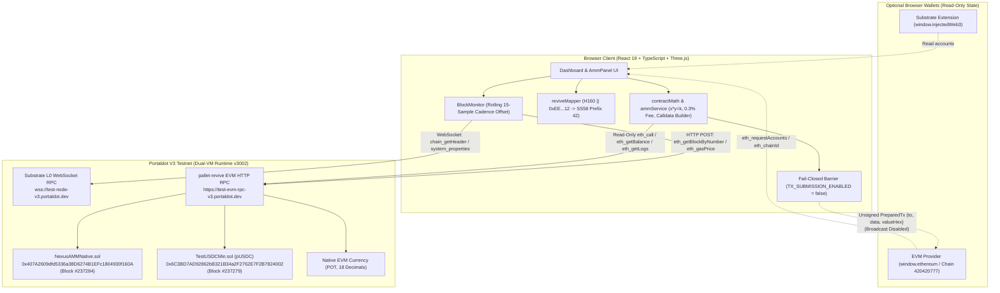

# PortalNexus — Technical Architecture

PortalNexus is a Dual-VM observability, address-derivation, and Constant-Product Automated Market Maker (AMM) terminal purpose-built for **Portaldot V3 Testnet** (`Chain ID 420420777`, `pallet-revive` runtime `v3002`).

---

## 1. System Topology

---

## 2. Why Architecture A Was Engineered for `pallet-revive`

Unlike legacy Polkadot Frontier (`pallet-evm`) chains where contract deployment is billed purely as EVM execution gas, Portaldot V3 executes Solidity contracts on Polkadot SDK's **`pallet-revive`** (`eth-rpc` adapter). Under `pallet-revive`, contract deployment and new storage slots lock refundable **Substrate state rent (storage deposit)** inside the `eth_estimateGas` limit:

$$\text{eth\_gas} \approx \text{ExecutionWeightToGas} + \frac{\text{StorageDeposit}}{\text{gasPrice}}$$

Empirical benchmarks at Block `#236250` (`gasPrice = 27,695 wei`) established:
- **Base Trie Account Overhead:** $\approx 18.32\text{ POT}$ per contract
- **Bytecode Storage Rate:** $\approx 0.0589\text{ POT}$ per byte
- **New Mapping Slot Deposit:** $\approx 3.92\text{ to }7.82\text{ POT}$ per storage item

| Architecture Variant | Contracts Required | Total Bytecode | Required State Rent | Deployment Outcome |
| :--- | :--- | :--- | :--- | :--- |
| **Original 3-Contract Suite** (`WPotToken` + `TestUSDC` + `NexusAMM` + `NexusLPReceipt`) | 3–4 contracts | ~15,580 bytes | `~1,090.86 POT` | Exceeded 420.90 POT deployer budget |
| **Architecture A (Deployed)** (`TestUSDCMin` + `NexusAMMNative`) | **2 contracts** | **4,787 bytes** | **`407.81 POT`** | **Deployed & Verified On-Chain** (`13.088 POT` margin remaining) |

### Key Architecture A Design Decisions:
1. **Direct Native POT Pairing (`msg.value`):** Eliminates `WPotToken.sol` entirely. Users supply and receive native `POT` directly via payable functions (`addLiquidity`, `swapExactPOTForTokens`) and native transfers (`to.call{value: amount}("")`).
2. **Unified ERC-721 LP Receipts:** Position NFT ownership (`ownerOf`, `balanceOf`, `getPosition`) is embedded directly inside `NexusAMMNative.sol` (`receiptContract() == address(this)`), eliminating cross-contract calls and saving ~416 POT in deployment state rent.
3. **Zero-Dependency ABI Layer (`src/contracts/abi.ts`):** The frontend encodes and decodes all contract calls using pure BigInt/hex routines verified directly against the compiled Hardhat artifacts in `tests/liveIntegration.test.ts`.

---

## 3. Dual-VM Address Derivation (`src/lib/reviveMapper.ts`)

Portaldot V3 (`pallet-revive`) maps between 20-byte EVM `H160` addresses and 32-byte Substrate `AccountId32` accounts using two mechanisms:

1. **Deterministic Fallback (`AccountId32Mapper`):**
   $$\text{AccountId32} = \text{H160 (20 bytes)} \;\|\; \text{0xEEEEEEEEEEEEEEEEEEEEEEEE (12 bytes)}$$
   Encoded with SS58 Prefix `42` and a 2-byte `blake2b-512("SS58PRE" || ...)` checksum.
   - Example: Deployer `0xdC7f5c7813a5f0e3F51c2Fe569DE6C5577768A2A` maps deterministically to `5H3pE4SQzSxPN5zuN1cqo7TbY7QuA9wHo3areDQDVLy2AUbu`.
2. **Registered Mapping (`Revive::OriginalAccount`):**
   $$\text{H160} = \text{keccak256}(\text{AccountId32})[12..32]$$

> [!WARNING]
> Legacy Frontier tools (`@polkadot/util-crypto` `evmToAddress`) hash `blake2_256("evm:" + H160)`, which produces an unrecoverable address on `pallet-revive`. `reviveMapper.ts` explicitly guards against this error.

---

## 4. Read-Only vs. Guarded Transaction Paths

- **Live On-Chain Reads (Active):**
  - `NexusAMMNative.getReserves()` (`0x0902f1ac`)
  - `NexusAMMNative.totalLiquidityShares()` (`0x87cd5b20`)
  - `NexusAMMNative.ownerOf(uint256)` (`0x6352211e`) & `getPosition(uint256)` (`0xeb02c301`)
  - `TestUSDCMin.totalSupply()` (`0x18160ddd`), `balanceOf(address)` (`0x70a08231`), `allowance(address,address)` (`0xdd62ed3e`)
  - `eth_getBalance` and `eth_getLogs` (filtered from deploy block `#237284` with `LiquidityAdded` topic `0x08d7621a...`)
- **Transaction Preparation (Active, Unsigned):**
  - `prepareFaucetMint`, `prepareApprove` (exact allowance, never `MaxUint256`), `prepareAddLiquidity`, `prepareRemoveLiquidity`, `prepareSwapPotForUsdc`, `prepareSwapUsdcForPot`.
- **Transaction Broadcast (Disabled):**
  - Controlled by `TX_SUBMISSION_ENABLED = false` in [`src/services/ammService.ts`](../src/services/ammService.ts). The UI never calls `eth_sendTransaction`.
